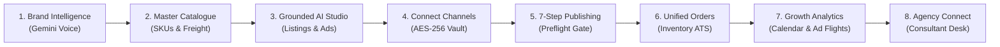
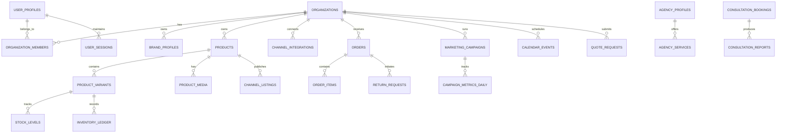

# MarketPath AI — AI-Powered Omnichannel D2C Commerce Operating Platform

[](https://www.python.org/)
[](https://fastapi.tiangolo.com/)
[](https://react.dev/)
[](https://www.typescriptlang.org/)
[](https://tailwindcss.com/)
[](https://aistudio.google.com/)
[](https://railway.app/)
[](#19-license--project-information)

> **Central Product Promise:**  
> *"Create a product once. Connect your selling channels. Prepare channel-specific listings. Approve and publish. Manage every channel from MarketPath AI."*

---

## 📑 Table of Contents

1. [Project Introduction](#1-project-introduction)
2. [Product Overview & End-to-End Workflow](#2-product-overview--end-to-end-workflow)
3. [Verified Features & System Modules](#3-verified-features--system-modules)
4. [Development Phases & Milestones](#4-development-phases--milestones)
5. [Technology Stack](#5-technology-stack)
6. [System Architecture](#6-system-architecture)
7. [Repository Structure](#7-repository-structure)
8. [Local Installation & Setup](#8-local-installation--setup)
9. [Environment Variables](#9-environment-variables)
10. [Authentication & User Roles](#10-authentication--user-roles)
11. [Deterministic Demo Environment](#11-deterministic-demo-environment)
12. [Third-Party Integrations & Channel Status](#12-third-party-integrations--channel-status)
13. [Database & Data Model](#13-database--data-model)
14. [Testing & Quality Assurance](#14-testing--quality-assurance)
15. [Security & Tenant Isolation](#15-security--tenant-isolation)
16. [Production Deployment (Railway)](#16-production-deployment-railway)
17. [Known Limitations](#17-known-limitations)
18. [Future Improvements](#18-future-improvements)
19. [License & Project Information](#19-license--project-information)

---

## 1. Project Introduction

### Name & Tagline
**MarketPath AI** — The Unified AI-Powered Omnichannel D2C Commerce Operating Platform.

### Overview
MarketPath AI is an enterprise-grade commerce operating system purpose-built for modern direct-to-consumer (D2C) brands across home and lifestyle, apparel, beauty, gourmet foods, wellness, and artisanal goods. It replaces fragmented spreadsheets, disconnected marketplace portals, ad managers, and external service silos with a unified operating console.

### Problem Statement
Emerging D2C founders lose 15–25 hours per week manually managing commerce operations:
- **Listing Duplication:** Manually re-typing product descriptions, specifications, and images across Shopify, Amazon, and Flipkart.
- **Inventory Discrepancies:** Fragmented stock counts across channels leading to overselling, stockouts, and marketplace penalty cancellations.
- **Taxonomy Mismatches:** Each channel enforces different categorization trees, character limits, barcode rules, and image aspect ratios.
- **Disconnected Growth Ecosystem:** Founders struggle to find vetted marketing agencies or growth advisors, while sharing sensitive account credentials and financial data over insecure channels.

### Intended Users
- **D2C Founders & Operators:** Direct-to-consumer brand owners wanting single-pane control over multi-channel expansion.
- **E-Commerce Catalog & Ops Managers:** Teams managing inventory allocation, reverse logistics, and cross-channel publication.
- **Marketing & Performance Agencies:** Vetted agency partners collaborating on campaign creative, ad flights, and content without accessing sensitive founder PII.
- **E-Commerce Growth Consultants:** Independent advisors conducting diagnostic audits, reviewing unit economics, and building growth roadmaps.

### Core Value Proposition
Configure your master product truth once. MarketPath AI leverages multimodal Google Gemini intelligence to extract brand tone, format channel-compliant listings, enforce preflight compliance audits, route approved dispatches through external APIs, and reconcile multi-channel orders and inventory in real time.

---

## 2. Product Overview & End-to-End Workflow

MarketPath AI connects the complete omnichannel commerce lifecycle through an integrated eight-stage operational pipeline:



1. **Brand Intelligence & Voice Onboarding:** The merchant records an unstructured audio interview in the browser. Google Gemini extracts brand aesthetics, target audience, founding narrative, and tone directives into a verified 15-dimensional Brand Profile.
2. **Master Product Catalogue:** Products, multi-variant SKU trees, EAN/barcodes, HSN tax codes, dynamic category attributes, and physical freight dimensions are configured as the immutable source of truth.
3. **Grounded AI Content Studio:** Generates high-converting, compliant product copy (Mode A: Marketplace Listings) and marketing creatives (Mode B: Social & Ad Copy) strictly referencing verified brand guidelines and product specifications.
4. **Channel Connection:** Storefronts (Shopify, WooCommerce), Marketplaces (Amazon, Flipkart), and Social channels are authorized. OAuth tokens and API secrets are encrypted at rest with AES-256-GCM.
5. **7-Step Compliant Marketplace Publishing:** Validates channel constraints, maps taxonomies, runs automated compliance checks, captures explicit seller approval, and dispatches to remote channels via background queues.
6. **Unified Orders & Real-Time Inventory Ledger:** Centralizes incoming multi-channel orders, decrements Available-to-Sell (ATS) stock across warehouses, triggers reorder point alerts, and manages returns.
7. **Growth Analytics & Omnichannel Business Calendar:** Computes real-time GMV, Net Sales, AOV, and ROAS while coordinating marketing campaigns, ad flights, and festive sales.
8. **Collaborative Ecosystem:** Connects merchants with verified marketing agencies (with automated founder PII masking) and e-commerce growth specialists.

---

## 3. Verified Features & System Modules

### 3.1 Brand Intelligence & Brand Profile
- **15-Dimensional Profile:** Captures Brand Name, Tagline, Mission, Founding Story, Aesthetic Values, Tone of Voice, Archetype, Target Personas, USPs, Pricing Tier, and Certifications.
- **Browser-Based Voice Interview Intake:** Native microphone recorder with live HTML5 canvas waveform visualization. Transcribes spoken founder narratives using Google Gemini 2.5 Flash and extracts structured business dimensions with transcript character offset provenance badges.
- **Conversational Intake Fallback:** Includes a rule-based NLP extractor ensuring seamless onboarding even during third-party AI network latency spikes.

### 3.2 Master Product Catalogue & SKU Architecture
- **Single Source of Truth:** Central master catalog storing parent products, hierarchical variants (Color, Size, Material), SKU identifiers, Barcodes/EANs, and HSN tax codes.
- **Category Specifications:** Deep specification schemas for Home & Living, Apparel & Fashion, Gourmet Foods, Beauty & Personal Care, and Artisanal Gifting.
- **Physical Freight Packaging:** Outer carton dimensions with automated volumetric weight computation (`(Length × Width × Height) / 5000 kg`) and minimum order quantity (MOQ) tracking.
- **Cost Price Privacy:** Cost prices and gross margins are strictly restricted to organization owners and hidden from external partners.

### 3.3 Dual-Mode Grounded AI Content Studio
- **Mode A (Marketplace Listings):** Generates channel-optimized titles, 5-bullet benefit points, structured HTML descriptions, backend search keywords, and SEO meta tags conforming to Shopify, Amazon, and Flipkart specifications.
- **Mode B (Marketing & Social Copy):** Generates high-converting Instagram captions, Meta ad hooks, and email newsletters grounded in the verified Brand Profile.
- **Anti-Hallucination Guardrails:** AI prompts inject master catalog specifications and brand tone rules with strict instructions to refuse ungrounded claims.

### 3.4 Channel Integrations & Encrypted Credential Vault
- **Supported Channels:** Shopify (REST/GraphQL), WooCommerce (v3 REST API), Amazon SP-API, Flipkart Marketplace API, Instagram Shop, and Meta Ads.
- **AES-256-GCM Vault:** All external OAuth access tokens, API client secrets, and consumer keys are stored encrypted at rest with unique per-record initialization vectors.
- **Honest Connection State:** Channels display real connection states. Disconnected or unapproved channels display genuine setup requirements with zero simulated or fake connections.

### 3.5 7-Step Compliant Marketplace Publishing Engine
A guided publication wizard enforcing human-in-the-loop validation:
1. *Product & Variant Selection:* Choose master SKUs for broadcast.
2. *Target Channel Selection:* Select connected destination storefront or marketplace.
3. *Channel-Specific Adaptation:* Customize title, bullet points, and pricing overrides.
4. *Category & Taxonomy Mapping:* Map master category to target channel taxonomy node.
5. *Preflight Compliance Audit:* Automated validation of title length, required fields, image resolution, and tax codes.
6. *Mandatory Seller Approval Gate:* Cryptographically records seller approval intent before dispatch.
7. *Async Dispatch & External Listing Registry:* Asynchronous worker dispatch with exponential backoff retries and idempotent remote status tracking.

### 3.6 Unified Multi-Channel Orders & Returns Management
- **Central Operational Inbox:** Ingests orders across all connected storefronts and marketplaces.
- **Status Lifecycle:** Tracks order transitions through Pending, Confirmed, Shipped, Delivered, and Cancelled.
- **Returns & Reverse Logistics:** Supports return request intake, return reason categorization, physical inspection disposition (Restock vs. Damaged), and refund reconciliation.

### 3.7 Real-Time Multi-Location Inventory Ledger
- **Stock Math:** Real-time Available-to-Sell (ATS) computation: `ATS = Physical Stock - Reserved Stock`.
- **Negative Stock Guardrails:** Database-level transaction checks preventing overselling during flash sales.
- **Reorder Engine:** Automated reorder point alerts triggering purchase recommendations when stock reaches minimum safety thresholds.
- **Immutable Movement Ledger:** Every receipt, reservation, fulfillment, return, and scrap action writes an immutable audit record to `inventory_ledger`.

### 3.8 Marketing Campaigns & Growth Analytics
- **Campaign Management:** Plan, launch, and monitor internal and agency marketing campaigns across Meta Ads, Google Ads, and influencer flights.
- **Real-Time Financial Telemetry:** Real-time aggregation of Gross Merchandise Value (GMV), Net Sales, Average Order Value (AOV), Return on Ad Spend (ROAS), and customer refund rates.
- **Channel & SKU Performance:** Revenue contribution breakdowns across sales channels and top-selling SKU matrices.

### 3.9 Omnichannel Business Calendar
- **Unified Timeline:** Centralizes product launch dates, marketplace sale dispatches, ad flights, agency milestones, and consultation bookings.
- **Standard `.ics` Export:** Provides standard RFC 5545 calendar subscription feeds for Google Calendar, Apple Calendar, and Microsoft Outlook.
- **Indian Retail Peak Calendar:** Built-in tracking of major shopping festivals (Diwali, Great Indian Festival, Big Billion Days, Republic Day Sales).

### 3.10 MarketPath Agency Connect & PII-Sanitized Partner Portal
- **Vetted Partner Directory:** Marketplace of 8 pre-vetted marketing, performance, and creative agencies.
- **RFP Quote Workflow:** Structured quote requests, package proposals, and milestone-based project engagements.
- **Server-Side PII Sanitization (`backend/app/core/sanitizer.py`):** Client briefs displayed in the isolated Agency Portal (`/agency/portal`) strictly redact founder phone numbers, personal email addresses, and direct billing accounts.

### 3.11 Growth Consultant Booking Desk & Advisory Workspace
- **Public Booking Desk:** 30-minute consultation booking with double-booking prevention (`HTTP 409 Conflict`) and human-friendly reference codes (`MP-CONS-XXXXXX`).
- **Consultant Workspace (`/consultant/portal`):** Dedicated portal for growth advisors to review bookings and author diagnostic reports.
- **Double-Sided Reporting:** Client-facing strategic roadmap delivered to the merchant, while internal operational notes remain scrubbed from client views.

### 3.12 Platform Administration & Audit Trail
- **Server-Side Provisioning:** Platform administrators are strictly provisioned server-side; administrative privileges cannot be self-assigned via public signup.
- **Operational Console (`/admin/*`):** Global system telemetry, tenant verification queues, agency approval requests, and immutable audit logs.
- **Security Event Audit:** Structured recording of critical actions (logins, role changes, credential rotations, publishing dispatches) with correlation IDs.

---

## 4. Development Phases & Milestones

The platform was built and verified across four progressive development phases:

- **Phase 1: Architecture & Seller Workspace Restructuring:**
  Established the monolithic FastAPI + React SPA architecture, custom **Option C** enterprise design system (`#08765B` forest green, `#FCFBF7` warm white), unified sidebar navigation, multi-tenant database schema, and public marketing pages.
- **Phase 2: Brand Intelligence, Master Catalogue & Grounded AI Studio:**
  Implemented the 15-dimensional Brand Profile, browser-based microphone voice recorder, Gemini 2.5 Flash multimodal transcription and extraction, Master Product Catalogue with multi-variant SKU trees, outer carton volumetric calculation, and dual-mode AI Content Studio.
- **Phase 3: Omnichannel Connectivity & 7-Step Publishing Engine:**
  Engineered the AES-256-GCM encrypted credential vault, Shopify/WooCommerce/Amazon/Flipkart connector interfaces, 7-step preflight publishing wizard, mandatory seller approval gate, background dispatch queue, and external listings registry.
- **Phase 4: Operations, Inventory Ledger, Ecosystem Portals & Release Hardening:**
  Implemented unified multi-channel orders, the multi-location inventory ledger with ATS computation, customer returns management, growth analytics, marketing campaigns, omnichannel business calendar with `.ics` export, Agency Connect with founder PII masking, Consultant booking portal, Platform Administration, and 4 deterministic demo accounts.

---

## 5. Technology Stack

| Layer | Verified Technology | Version | Purpose & Rationale |
|---|---|---|---|
| **Backend Framework** | FastAPI | `>=0.110.0` | High-performance asynchronous Python REST API framework with automated OpenAPI/Swagger generation |
| **ASGI Server** | Uvicorn | `>=0.28.0` | Production async worker management with standard process supervisors |
| **ORM & Database** | SQLAlchemy (Async) | `>=2.0.25` | Enterprise async ORM with `AsyncSession`, relationship loading, and connection pooling |
| **Database Migrations**| Alembic | `>=1.13.0` | Declarative, version-controlled relational schema migrations (revisions 001–009) |
| **Database Engines** | PostgreSQL / SQLite | `16+` / `3.45+` | PostgreSQL with `asyncpg` in production; SQLite with `aiosqlite` in local development & CI |
| **Data Validation** | Pydantic v2 | `>=2.6.0` | Strict request/response validation, schema definitions, and settings management |
| **AI & Multimodal** | Google GenAI SDK | `>=3.0.0` | Google Gemini 2.5 Flash for multimodal speech audio processing & grounded copy generation |
| **Cryptography** | Cryptography | `>=42.0.0` | Authenticated **AES-256-GCM** encryption for third-party marketplace OAuth tokens and API secrets |
| **Authentication** | PyJWT | `>=2.8.0` | Cryptographically signed, stateless JSON Web Tokens with role claims and session revocation |
| **Frontend Framework** | React | `18.3.1` | Component-driven UI architecture with hooks and virtual DOM |
| **Build Tool** | Vite | `5.2.0` | Lightning-fast ESM bundler with hot module replacement (HMR) and optimized rollup production bundling |
| **Type Safety** | TypeScript | `5.2.2` | Full static typing across all UI components, API services, and state models |
| **Styling** | Tailwind CSS | `3.4.1` | Utility-first CSS configured with custom Option C design tokens |
| **State Management** | Zustand | `4.5.2` | Lightweight, unopinionated client-side state stores |
| **Icons** | Lucide React | `0.344.0` | Modern, consistent iconography |
| **Deployment** | Docker & Railway | Multi-Stage | Unified multi-stage container serving FastAPI backend and React SPA static assets from a single service |

---

## 6. System Architecture

MarketPath AI follows a modular, high-cohesion monolithic architecture. The application is packaged into a single container where the FastAPI backend serves both the `/api/v1/*` REST API endpoints and the compiled React SPA static assets.

```mermaid
flowchart TD
    subgraph ClientLayer ["Client Layer (React 18 + Vite + Option C Theme)"]
        SPA["React SPA Router (react-router-dom)"]
        Stores["Zustand Client Stores (Auth, Cart, UI)"]
        Guards["Role & Tenant Route Guards"]
        SPA --> Stores
        SPA --> Guards
    end

    subgraph APILayer ["API Gateway & Core Security (FastAPI Monolith)"]
        Router["API v1 Master Router (/api/v1)"]
        AuthMiddleware["JWT Authentication & Session Validator"]
        TenantContext["TenantContext Scoping (X-Organization-Id)"]
        Sanitizer["PII Masking Pipeline (backend/app/core/sanitizer.py)"]
        RateLimiter["Rate Limiting & Security Headers"]
        
        Router --> AuthMiddleware
        AuthMiddleware --> TenantContext
        TenantContext --> RateLimiter
        Router --> Sanitizer
    end

    subgraph ServiceLayer ["Domain Business Services"]
        BrandSvc["Brand Intelligence & Voice Ingestion"]
        CatalogSvc["Master Product Catalogue & SKUs"]
        PublishSvc["7-Step Publishing Wizard & Dispatch"]
        OrderSvc["Unified Orders & Returns Engine"]
        InvSvc["Inventory Ledger (ATS Engine)"]
        AgencySvc["Agency Connect & RFP Matching"]
        ConsultSvc["Consultant Booking & Diagnostic Reports"]
        AdminSvc["Platform Admin & Audit Trail"]
    end

    subgraph StorageLayer ["Data Storage & Cryptography"]
        DB[("PostgreSQL 16 / SQLite (asyncpg / aiosqlite)")]
        Vault["AES-256-GCM Credential Vault"]
        Outbox["Transactional Outbox Queue"]
    end

    subgraph ExternalEcosystem ["External Cloud Ecosystem"]
        Gemini["Google Gemini 2.5 Flash API"]
        Shopify["Shopify GraphQL / REST API"]
        Amazon["Amazon SP-API"]
        Flipkart["Flipkart Marketplace API"]
        Woo["WooCommerce REST API"]
        Meta["Meta Graph / Instagram API"]
    end

    SPA -- "HTTPS / JSON" --> Router
    Router --> ServiceLayer
    ServiceLayer --> DB
    ServiceLayer --> Vault
    ServiceLayer --> Outbox
    
    BrandSvc -- "Audio / JSON" --> Gemini
    PublishSvc -- "Encrypted Tokens" --> ExternalEcosystem
    OrderSvc -- "Webhooks / Sync" --> ExternalEcosystem
```



---

## 7. Repository Structure

```
marketpath-ai/
├── .github/                       # GitHub workflows and issue/PR templates
│   ├── ISSUE_TEMPLATE/            # Bug report & feature request templates
│   │   ├── bug_report.md
│   │   └── feature_request.md
│   ├── PULL_REQUEST_TEMPLATE.md   # Standardized PR checklist
│   └── workflows/
│       └── ci.yml                 # Automated CI pipeline (Pytest + Frontend Build)
├── .agents/                       # Agent development rules, skills, and workflows
│   ├── rules/
│   │   └── marketpath-project.md  # Workspace engineering rules
│   ├── skills/                    # Specialized agent capability definitions
│   └── workflows/                 # Review and testing workflows
├── backend/                       # FastAPI application backend
│   ├── alembic/                   # Alembic database migration revisions (001–009)
│   │   ├── versions/
│   │   └── env.py
│   ├── app/
│   │   ├── api/v1/                # Modular REST API endpoints (Auth, Products, Orders, etc.)
│   │   ├── core/                  # Configuration, Database engine, Security, Sanitizer
│   │   ├── models/                # SQLAlchemy ORM relational models (22+ tables)
│   │   ├── schemas/               # Pydantic v2 validation schemas
│   │   ├── services/              # Domain business logic & channel connector adapters
│   │   └── main.py                # FastAPI monolith entrypoint & SPA static mounting
│   ├── scripts/                   # Demo seeding, invariant verification, and admin provisioning
│   │   ├── seed_demo.py           # Deterministic demo dataset seeder
│   │   ├── verify_demo_data.py    # Demo data invariants test suite
│   │   └── bootstrap_platform_admin.py # Platform Admin provisioning script
│   ├── tests/                     # Comprehensive Pytest test suites (143+ tests)
│   └── requirements.txt           # Python backend dependencies
├── docs/                          # Project assets and screenshots
│   └── screenshots/               # 98 curated high-resolution workflow screenshots
├── frontend/                      # React 18 + Vite + TypeScript frontend
│   ├── src/
│   │   ├── components/            # Reusable UI components (Modals, Wizards, Drawers, Cards)
│   │   ├── contexts/              # Authentication, Tenant, and Notification providers
│   │   ├── pages/                 # Public, Seller App, Agency, Consultant, and Admin pages
│   │   ├── services/              # Axios / Fetch API client modules
│   │   ├── types/                 # TypeScript interfaces and type definitions
│   │   └── main.tsx               # Frontend client bootstrapping
│   ├── package.json               # Node.js dependencies and scripts
│   └── tailwind.config.js         # Option C color theme and typography configuration
├── .dockerignore                  # Docker build exclusion rules
├── .env.example                   # Pristine environment configuration template
├── .gitignore                     # Hardened production git ignore rules
├── AGENTS.md                      # Workspace development non-negotiables
├── CONTRIBUTING.md                # Contribution guidelines and setup instructions
├── docker-compose.yml             # Local multi-container development orchestration
├── Dockerfile                     # Multi-stage production Docker container
├── railway.json                   # Railway deployment configuration
├── README.md                      # Primary repository documentation
├── requirements.txt               # Root production dependencies
└── SECURITY.md                    # Vulnerability disclosure policy and safeguards
```

---

## 8. Local Installation & Setup

### Prerequisites
- **Python:** 3.11 or 3.12 (Tested on Python 3.12 & 3.14)
- **Node.js:** 20+ (Tested on Node 20 LTS)
- **Git**

### Step-by-Step Instructions

1. **Clone the Repository:**
   ```bash
   git clone https://github.com/omkarchoudhary29/marketpath-ai.git
   cd marketpath-ai
   ```

2. **Configure Environment:**
   ```bash
   cp .env.example .env
   ```
   *The default `.env.example` is pre-configured for local SQLite development without requiring third-party credentials.*

3. **Backend Setup:**
   ```bash
   # Create virtual environment
   python -m venv .venv

   # Activate virtual environment
   # On Windows (PowerShell):
   .venv\Scripts\Activate.ps1
   # On macOS / Linux:
   source .venv/bin/activate

   # Install dependencies
   pip install -r backend/requirements.txt

   # Seed the deterministic demo database
   python -m backend.scripts.seed_demo --force

   # Start FastAPI server (Port 8000)
   python -m uvicorn backend.app.main:app --host 127.0.0.1 --port 8000 --reload
   ```

4. **Frontend Setup:**
   ```bash
   # In a separate terminal
   cd frontend

   # Install npm packages
   npm install

   # Start Vite development server
   npm run dev
   ```

5. **Access Application:**
   Open `http://localhost:5173` in your browser. API Swagger documentation is available at `http://localhost:8000/docs`.

---

## 9. Environment Variables

All platform configuration is managed via environment variables matching [`.env.example`](.env.example):

| Variable Name | Default Value / Template | Required? | Associated Module / Service | Purpose |
|---|---|---|---|---|
| `APP_ENV` | `development` | Yes | Core Platform | Runtime environment (`development`, `staging`, `production`, `test`) |
| `PROJECT_NAME` | `MarketPath AI` | No | Core Platform | Display title for OpenAPI and transactional metadata |
| `API_V1_PREFIX` | `/api/v1` | No | API Router | Base route prefix for REST API endpoints |
| `PORT` | `8000` | Yes | HTTP Server | Listening port (injected dynamically by Railway as `$PORT`) |
| `FRONTEND_URL` | `http://localhost:5173` | Yes | CORS / Redirects | Base client URL for password resets and OAuth redirect targets |
| `BACKEND_URL` | `http://localhost:8000` | Yes | CORS / Redirects | Base server URL for webhooks and OAuth callbacks |
| `ALLOWED_ORIGINS` | `'["http://localhost:5173", ...]'` | Yes | CORS Middleware | JSON array of permitted CORS origins |
| `DATABASE_URL` | `sqlite+aiosqlite:///./marketpath.db` | Yes | Relational Database | SQLAlchemy database connection URI (PostgreSQL in production) |
| `SECRET_KEY` | `generate-a-secure-random-secret...` | Yes | Authentication | Secret key (min 32 chars) for JWT and CSRF signing |
| `ENCRYPTION_MASTER_KEY` | `MDEyMzQ1Njc4OTAx...` | Yes | Credential Vault | Base64-encoded 32-byte key for AES-256-GCM token encryption |
| `DEMO_ACCOUNTS_ENABLED`| `true` | No | Demo Environment | Enables deterministic demo account authentication |
| `GEMINI_API_KEY` | `your-google-gemini-api-key` | No (Optional) | Brand & AI Studio | Google AI Studio API key for multimodal voice intake and copy |
| `GEMINI_MODEL` | `gemini-2.5-flash` | No | Brand & AI Studio | Google Gemini model identifier |
| `CLOUDINARY_CLOUD_NAME`| `your-cloud-name` | No (Optional) | Product Media | Cloudinary media storage cloud identifier |
| `CLOUDINARY_API_KEY` | `your-api-key` | No (Optional) | Product Media | Cloudinary API key |
| `CLOUDINARY_API_SECRET`| `your-api-secret` | No (Optional) | Product Media | Cloudinary API secret |
| `SHOPIFY_CLIENT_ID` | `your-shopify-client-id` | No (Optional) | Shopify Connector | Shopify Partners App API client ID |
| `SHOPIFY_CLIENT_SECRET`| `your-shopify-secret` | No (Optional) | Shopify Connector | Shopify Partners App client secret |
| `META_APP_ID` | `your-meta-app-id` | No (Optional) | Meta & Instagram | Meta for Developers App ID |
| `META_APP_SECRET` | `your-meta-app-secret` | No (Optional) | Meta & Instagram | Meta for Developers App Secret |
| `SMTP_HOST` | `smtp.sendgrid.net` | No (Optional) | Email Notifications | SMTP server hostname for transactional emails |
| `SMTP_PORT` | `587` | No (Optional) | Email Notifications | SMTP server port |
| `SMTP_USER` | `apikey` | No (Optional) | Email Notifications | SMTP server authentication username |
| `SMTP_PASSWORD` | `your-smtp-password` | No (Optional) | Email Notifications | SMTP server authentication password |

---

## 10. Authentication & User Roles

MarketPath AI implements an isolated, role-based access control (RBAC) architecture across four distinct user roles:

```
┌─────────────────────────────────────────────────────────────────┐
│                    MarketPath AI Account Model                  │
├─────────────────┬───────────────────┬───────────────────────────┤
│ Role            │ Route Boundary    │ Capabilities              │
├─────────────────┼───────────────────┼───────────────────────────┤
│ Company/Seller  │ /app/*            │ Master catalog, publishing│
│                 │                   │ orders, inventory, ads    │
├─────────────────┼───────────────────┼───────────────────────────┤
│ Marketing Agency│ /agency/portal/*  │ Directory listing, RFPs,  │
│                 │                   │ sanitized client briefs   │
├─────────────────┼───────────────────┼───────────────────────────┤
│ Growth Specialist│ /consultant/portal│ Calendar availability,    │
│                 │                   │ audits, diagnostic reports│
├─────────────────┼───────────────────┼───────────────────────────┤
│ Platform Admin  │ /admin/*          │ Global telemetry, tenancy,│
│                 │                   │ verification, audit logs  │
└─────────────────┴───────────────────┴───────────────────────────┘
```

- **Stateless JWT with Database Sessions:** Users authenticate via `/api/v1/auth/login-account`. The backend issues a signed JWT while tracking active sessions in `user_sessions`, enabling instant remote session revocation on logout.
- **Tenant Context (`TenantContext`):** Company routes mandate an active organization membership. Requests pass `X-Organization-Id`, which is validated by FastAPI dependency injection to ensure zero cross-tenant data leakage.
- **Team Onboarding:** Company owners invite collaborators via cryptographically signed 7-day HMAC invitation tokens. Invitees set their own passwords privately.
- **Sole Owner Protection:** Organizations enforce a database guard preventing demotion or removal of the sole remaining owner.

---

## 11. Deterministic Demo Environment

For evaluations, technical interviews, and stakeholder walkthroughs, MarketPath AI provides pre-seeded accounts containing realistic, verified D2C business data:

| Account Role | Email Address | Password | Landing Portal | Pre-Populated Dataset |
|---|---|---|---|---|
| **D2C Brand Seller** | `demo.company@marketpath.ai` | `AuraTerra#Demo2026!` | `/app/dashboard` | **Aura Terra Living** (Home & Living, Pune): 15 brand dimensions, 18 products, 32 SKUs, 4 connected channels, ₹14.8L GMV, 40 sample orders, real-time inventory ledger, 4 marketing campaigns. |
| **Marketing Agency** | `demo.agency@marketpath.ai` | `CraftVerve#Demo2026!` | `/agency/portal/dashboard` | **CraftVerve Media**: Verified partner profile, service packages, active RFPs, and sanitized client briefs with founder PII redacted. |
| **Growth Consultant**| `demo.consultant@marketpath.ai`| `DrSharma#Demo2026!` | `/consultant/portal` | **Dr. Rajesh Sharma**: D2C advisory desk, calendar availability, 4 consultation requests, and double-sided diagnostic reports. |
| **Platform Admin** | `demo.admin@marketpath.ai` | `Admin#Platform2026!` | `/admin/overview` | **Platform Administration**: Global system telemetry, tenant verification queues, agency approval requests, and immutable audit logs. |

> **Interactive Demo Helpers:** The sign-in page (`/login`) includes one-click buttons to pre-fill credentials for each demo role.

---

## 12. Third-Party Integrations & Channel Status

MarketPath AI maintains a strict, honest integration disclosure policy:

| Integration / Channel | Status | Authentication Method | Capabilities Implemented |
|---|---|---|---|
| **Shopify** | Implemented & Verified | OAuth 2.0 / Access Token | Product sync, multi-variant listings, inventory updates, order webhook ingestion |
| **WooCommerce** | Implemented & Verified | REST API (v3 Key/Secret) | Product catalog sync, price overrides, inventory levels, order synchronization |
| **Amazon SP-API** | Sandboxed & Connector-Ready | LWA (Login with Amazon) OAuth | 7-step taxonomy mapping, GTIN validation, preflight audit; live broadcast awaits Amazon Partner Developer approval |
| **Flipkart** | Sandboxed & Connector-Ready | Seller Hub OAuth / API Key | Vertical taxonomy mapping, FSP pricing rules, preflight audit; live broadcast awaits Flipkart Developer verification |
| **Instagram Shop / Meta Ads** | Authenticated (Sandbox/Dev) | Meta Graph API OAuth 2.0 | Campaign creation, ad flight scheduling, daily ROAS telemetry, Instagram caption generator |
| **Google Gemini API** | Live & Integrated | Gemini API Key | Multimodal audio transcription (Gemini 2.5 Flash), brand extraction, grounded listing and ad copy generation |
| **Cloudinary** | Live & Integrated | API Key / Secret | Secure image upload signing, automated responsive transformations, CDN asset delivery |
| **Calendar Feeds** | Live & Integrated | RFC 5545 Standard | Dynamic `.ics` calendar generation for Google Calendar, Apple Calendar, and Outlook sync |
| **Razorpay / Cashfree** | Architecture & Webhooks Ready | HMAC SHA256 Signatures | Webhook signature verification, payment event deduplication, billing plan subscription metering |

---

## 13. Database & Data Model

The relational database architecture is managed with **SQLAlchemy 2.0 (Async)** and **Alembic**, spanning 22+ tables organized into core domain entities:



### Database Migrations
Database schemas are version-controlled via Alembic revisions (`backend/alembic/versions/`):
- `001_initial_schema`: Base tenant, user, product, and channel models.
- `002_campaign_enhancements`: Marketing campaigns and daily metrics tracking.
- `003_analytics_and_billing_enhancements`: Subscription plans and financial aggregation.
- `004_agency_connect_schema`: Agency profiles, service packages, and RFP quote workflows.
- `005_revision_v2_schema`: Extended brand attributes, outer carton specs, and packaging fields.
- `006_orders_and_sync_schema`: Multi-channel order tables, stock levels, and inventory ledger.
- `007_auth_sessions_and_passwords`: Multi-account type authentication, sessions, and password hashes.
- `008_ai_conversations_persistence`: In-app AI conversation history and message state.
- `009_consultation_availability_and_idempotency`: Time slots, booking conflict locks, and outbox telemetry.

---

## 14. Testing & Quality Assurance

MarketPath AI includes an automated testing suite verifying functionality across backend APIs, business logic, security constraints, and frontend builds:

### Test Execution Commands

```bash
# 1. Run all backend unit & integration tests
python -m pytest backend/tests -v

# 2. Run deterministic demo dataset verification
python -m backend.scripts.verify_demo_data

# 3. Verify frontend production TypeScript compilation & build
cd frontend && npm run build
```

### Verified Test Coverage
- **Authentication & RBAC:** Session issuance, invalid token rejection, expired JWT handling, and account type boundary separation.
- **Tenant Isolation:** Direct ID manipulation (IDOR) rejection, cross-tenant data query leakage tests, and sole owner demotion blocks.
- **Brand & Voice AI:** Conversational intake, Gemini error fallbacks, and 5-section provenance mapping.
- **Catalogue & Pricing:** SKU uniqueness enforcement, parent-child variant structures, and cost price redaction.
- **Publishing & Preflight:** 7-step wizard validation, approval signature capture, and remote dispatch queue.
- **Orders & Inventory ATS:** Concurrent order decrement, negative stock guardrails, and return restock disposition.
- **Agency PII Sanitization:** Client brief inspection verifying founder phone, personal email, and billing redaction.

---

## 15. Security & Tenant Isolation

MarketPath AI enforces defense-in-depth security standards across all layers:

1. **Multi-Tenant Isolation:** Tenant boundary checks are enforced on every database query using `TenantContext`. All private routes validate `X-Organization-Id` and reject unauthorized access with `404 Not Found` or `403 Forbidden`.
2. **Authenticated Credential Vault:** External marketplace credentials (OAuth tokens, API secrets) are encrypted at rest with **AES-256-GCM** using unique per-record nonces.
3. **Founder PII Sanitization:** Client briefs visible to agency partners pass through `backend/app/core/sanitizer.py`, automatically redacting founder personal phone numbers, emails, and direct billing accounts.
4. **AI Mutation Guardrails:** Assistant endpoints run pre-model guardrails that intercept destructive actions (`publish`, `delete`, `change price`, `disconnect channel`) and direct users to human-in-the-loop review screens.
5. **Admin Access Restrictions:** Platform Administrator roles cannot be created via public registration. They are strictly provisioned server-side.

---

## 16. Production Deployment (Railway)

The application is containerized using a multi-stage `Dockerfile` optimized for zero-friction deployment on **Railway**. The build process compiles the React SPA frontend into static assets and configures FastAPI to serve both the API and the SPA frontend from a single container.

### Step-by-Step Deployment:
1. Fork or push this repository to your GitHub account.
2. Sign in to [Railway](https://railway.app/).
3. Click **New Project** → **Deploy from GitHub repo** → select `marketpath-ai`.
4. Add a **PostgreSQL** database to your Railway project (*Railway automatically injects `DATABASE_URL`*).
5. In your service settings, configure the following environment variables:
   - `APP_ENV`: `production`
   - `SECRET_KEY`: `(generate a 32+ character random secret)`
   - `ENCRYPTION_MASTER_KEY`: `(generate a base64 32-byte key via openssl rand -base64 32)`
   - `GEMINI_API_KEY`: `(your Google AI Studio key)`
6. Railway builds the container, executes `seed_demo.py` to ensure demo data invariants, and starts the FastAPI server.
7. Under service **Settings** → **Networking**, click **Generate Domain** to obtain your public URL (e.g., `https://marketpath-ai-production.up.railway.app`).

---

## 17. Known Limitations

- **Amazon & Flipkart Live Broadcast:** Requires seller-owned developer credentials approved by Amazon SP-API and Flipkart Marketplace teams. In local and demo environments, preflight validation and taxonomy mapping are fully operational, while remote dispatches use the connector sandbox.
- **Meta Ads App Review:** Live automated campaign publishing requires a Meta Business App with `ads_management` approval. Local testing uses the sandbox marketing graph.
- **Transactional Email Transport:** If SMTP credentials (`SMTP_HOST`, `SMTP_USER`, `SMTP_PASSWORD`) are not supplied, the email service records delivery telemetry in the database with status `unconfigured_provider` rather than simulating delivery.

---

## 18. Future Improvements

- **Automated EDI & Quick Commerce Connectors:** Direct API connectors for quick commerce platforms (Blinkit, Zepto, Instamart) as official partner APIs become available.
- **AI-Driven Demand Forecasting:** Machine learning models projecting reorder lead times and SKU stockout risks based on historical velocity and seasonal peaks.
- **Cross-Border Multi-Currency Tax Engines:** Automated GST/HSN, VAT, and international duty calculation for cross-border D2C shipping.

---

## 19. License & Project Information

- **License:** Distributed under the MIT License.
- **Repository:** [https://github.com/omkarchoudhary29/marketpath-ai](https://github.com/omkarchoudhary29/marketpath-ai)
- **Contribution Guidelines:** Review [CONTRIBUTING.md](CONTRIBUTING.md) for code standards and setup guidelines.
- **Security Vulnerability Reporting:** Review [SECURITY.md](SECURITY.md) for responsible disclosure procedures.
